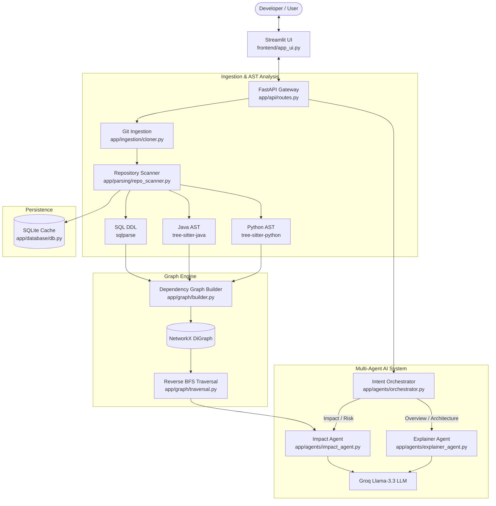

# ⚡ GitImpact

> **AI-Powered Codebase Intelligence & Change Blast-Radius Analysis Platform**

[](https://fastapi.tiangolo.com)
[](https://streamlit.io)
[](https://tree-sitter.github.io)
[](https://networkx.org)
[](https://groq.com)
[](LICENSE)

---

## 📌 Overview

**GitImpact** is an intelligent developer platform that answers the crucial engineering question:
> *"If I modify this function or refactor this file, what other parts of the codebase will break?"*

Instead of relying on fragile text searches or regex matching, **GitImpact** ingests any public GitHub repository, constructs concrete **Abstract Syntax Tree (AST)** representations using `tree-sitter`, models the code into a multi-level **Directed Dependency Graph** via `NetworkX`, and leverages **Groq-accelerated LLM Agents** to provide deep architectural insights and change impact analysis in plain English.

---

## ✨ Key Features

- 💬 **Natural Conversational Flow**: Start chatting casually, ask general questions, or paste a repository URL at any time.
- 🌳 **True AST Parsing**: Extracts functions, classes, imports, and calls with scope-tracking using `tree-sitter` (Python & Java) and `sqlparse` (SQL schemas).
- 🕸️ **Multi-Level Dependency Graph**: Tracks file containment (`contains`), function invocations (`calls`), and module imports (`imports`).
- 💥 **Change Blast-Radius Engine**: Reverse Breadth-First Search (BFS) graph traversal calculates exact topological distances for all downstream affected components.
- 🧠 **Multi-Intent AI Orchestrator**: Automatically routes questions to specialized agents:
  - **Whole Repository Overview**: Explains the core purpose, tech stack, and workflow.
  - **Directory Mapping**: Explains the exact responsibility of every directory.
  - **File Connections & Flow**: Analyzes dependencies and renders an interactive **Mermaid flowchart**.
  - **Specific Code Drilldown**: Explains specific functions or files.
  - **Blast-Radius Impact Analysis**: Evaluates risk and suggests testing checklists before deploying code changes.
- 📏 **Adaptive Response Length**: Automatically scales depth from quick 2-bullet TL;DRs to in-depth, step-by-step architectural walkthroughs.
- 🎨 **Modern Streamlit Dashboard**: Includes an active repository summary card, tech stack badges, an interactive directory explorer, and one-click quick prompt chips.

---

## 🏗️ Architecture & Data Flow



---

## 📂 Project Structure

```plaintext
GitImpact/
├── app/
│   ├── main.py                     # FastAPI entry point
│   ├── agents/
│   │   ├── orchestrator.py         # Multi-intent routing & adaptive length engine
│   │   ├── explainer_agent.py      # Architecture, repo, & file explainer agent
│   │   └── impact_agent.py         # Change blast-radius & risk assessment agent
│   ├── api/
│   │   └── routes.py               # REST API endpoints (/clone, /chat, /ask, /health)
│   ├── database/
│   │   └── db.py                   # SQLite persistence & metadata caching
│   ├── graph/
│   │   ├── builder.py              # AST dependency graph builder & Mermaid generator
│   │   └── traversal.py            # Reverse BFS topological distance traversal
│   ├── ingestion/
│   │   └── cloner.py               # Shallow Git repository cloner & path sanitizer
│   └── parsing/
│       ├── repo_scanner.py         # Directory mapper, tech stack detector, & README parser
│       ├── python_parser.py        # Tree-sitter AST parser for Python
│       ├── java_parser.py          # Tree-sitter AST parser for Java
│       └── sql_parser.py           # SQL DDL schema parser
├── frontend/
│   └── app_ui.py                   # Streamlit dashboard & interactive chat workspace
├── data/                           # Cloned repositories & SQLite database cache
├── .env.example                    # Template for environment variables
├── .gitignore                      # Git exclusion rules
├── requirements.txt                # Pinned production dependencies
└── README.md                       # Complete documentation
```

---

## 🚀 Getting Started

### 1. Prerequisites
- **Python 3.10+** (tested with Python 3.10 – 3.13)
- **Git** installed and available in your system path
- A free **Groq API Key** (get one at [console.groq.com](https://console.groq.com))

---

### 2. Installation

1. **Clone the repository:**
   ```bash
   git clone https://github.com/Khudbuddin/GitImpact.git
   cd GitImpact
   ```

2. **Create and activate a virtual environment:**
   ```bash
   # Windows (PowerShell)
   python -m venv venv
   .\venv\Scripts\Activate.ps1

   # Linux / macOS
   python3 -m venv venv
   source venv/bin/activate
   ```

3. **Install dependencies:**
   ```bash
   pip install -r requirements.txt
   ```

4. **Configure environment variables:**
   Copy the example `.env` file and insert your Groq API key:
   ```bash
   cp .env.example .env
   ```
   Open `.env` and set your key:
   ```env
   GROQ_API_KEY=gsk_your_groq_api_key_here
   GROQ_MODEL=llama-3.3-70b-versatile
   ```

---

### 3. Running GitImpact

You will need **two terminal windows**: one for the backend API and one for the frontend UI.

#### Terminal 1 — Start the FastAPI Backend:
```bash
uvicorn app.main:app --reload --host 127.0.0.1 --port 8000
```
*The API will be live at `http://127.0.0.1:8000`. You can visit `http://127.0.0.1:8000/docs` for interactive Swagger documentation.*

#### Terminal 2 — Start the Streamlit Frontend:
```bash
streamlit run frontend/app_ui.py
```
*The web interface will open automatically in your browser at `http://localhost:8501`.*

---

## 💡 Example Queries to Try

Once you paste a repository URL (e.g. `https://github.com/Khudbuddin/Smart-Expense-Categorizer`), you can ask anything:

| Query Type | Example Prompt |
| :--- | :--- |
| **High-Level Overview** | *"Explain the whole repo and its purpose"* |
| **Directory Map** | *"Which directory does what? Explain the folder structure."* |
| **Architecture & Flow** | *"How are files connected and what is the data flow?"* |
| **Main Entry Points** | *"What are the entry point files and how does execution start?"* |
| **Specific Code** | *"What does the `classify_intent` function do in `orchestrator.py`?"* |
| **Change Impact** | *"What will break if I change `clone_repository`?"* |
| **Concise Summary** | *"Briefly summarize what this project does in 2 bullets"* |
| **Deep Dive** | *"Walk me through the entire architecture step by step in detail"* |

---

## 🛡️ License

This project is licensed under the **MIT License**.
