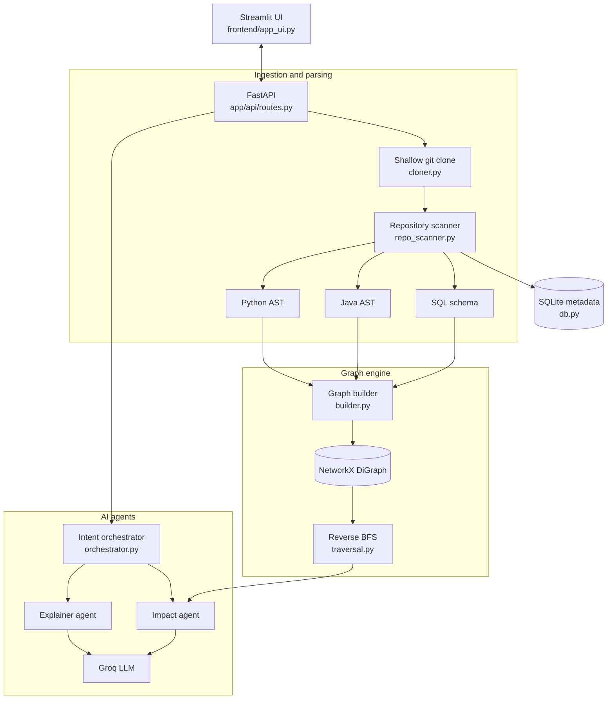

# GitImpact

A codebase intelligence platform that answers one engineering question: *"If I change this function or file, what else will break?"* GitImpact clones a public GitHub repository, parses it into ASTs, models it as a dependency graph, and uses LLM agents to explain the architecture and the impact of a change in plain English.


## Overview

Text search and regex can't tell you what depends on a function. GitImpact parses real syntax trees with `tree-sitter`, builds a directed dependency graph with `NetworkX`, and computes the blast radius of a change with a reverse breadth-first search. The LLM is then used only to explain results that were computed from the code, not to guess them.

## Features

- **AST parsing:** extracts functions, classes, imports and scoped function calls from Python and Java with `tree-sitter`, and tables and columns from SQL schemas with `sqlparse`.
- **Dependency graph:** file, function and table nodes connected by `contains`, `calls` and `imports` edges.
- **Blast-radius analysis:** reverse BFS over `calls` and `imports` edges returns every affected component with its distance from the change.
- **Grounded AI answers:** every prompt is built from a catalog of the repository's real files, functions and call edges, and the system prompt forbids inventing names.
- **Intent routing:** questions are routed to the right analysis, including repository overview, directory responsibilities, file-by-file walkthroughs, function call trees, function or file drill-down, and impact analysis. Typos in file and function names are tolerated.
- **Adjustable depth:** keywords such as "brief" or "step by step" switch answers between concise, normal and detailed modes.
- **Interactive studio:** a Streamlit app with chat, a force-directed dependency graph, a source and function explorer, and a blast-radius simulator.

## Architecture



### Parsing and graph model

`repo_scanner.py` walks the repository (skipping `.git`, virtual environments, `node_modules` and similar), parses `.py`, `.java` and `.sql` files, detects the tech stack from `requirements.txt`, `package.json` and Docker files, finds entry points, reads the README, and classifies each directory's purpose.

`builder.py` turns the parsed output into a graph:

| Node | Edge | Meaning |
|---|---|---|
| File | `contains` | File to its functions or tables |
| Function | `calls` | Function to the functions it calls (scoped to the enclosing function) |
| File | `imports` | File to the files it imports |

### Impact analysis

`find_impact` walks predecessors of the target over `calls` and `imports` edges and records each dependent's distance. The result is deterministic. The impact agent then sends the nearest dependents to the LLM to produce the direct impact, ripple effect and recommended tests. If nothing depends on the target, it reports that directly without calling the model.

### Intent routing

`orchestrator.py` resolves the file, function or directory named in a question (exact match first, then fuzzy matching) and routes it:

| Intent | Example question |
|---|---|
| Repository overview | "Explain the whole repo and its purpose" |
| Directory map or one directory | "Which directory does what?" |
| All files walkthrough | "Explain each file one by one" |
| Functions in a file | "What functions are in `routes.py`?" |
| Function call tree and pipeline | "How are files and functions connected?" |
| Function or file drill-down | "What does `route_and_execute_query` do?" |
| Impact analysis | "What breaks if I change `clone_repository`?" |
| Free-form repository Q&A | Any other question about the loaded repository |

## API

| Method | Endpoint | Purpose |
|---|---|---|
| GET | `/health` | Health check |
| POST | `/clone` | Clone a repository, parse it, build the graph, return summary data |
| POST | `/chat` | Conversational endpoint; routes the message by intent |
| POST | `/ask` | Question about a specific function in a cloned repository |

Interactive documentation is available at `http://127.0.0.1:8000/docs` when the backend is running.

## Project Structure

```text
GitImpact/
│
├── app/
│   ├── main.py                     # FastAPI application entry point
│   ├── agents/
│   │   ├── orchestrator.py         # intent routing, name matching, length modes
│   │   ├── explainer_agent.py      # Groq client and explanation prompts
│   │   └── impact_agent.py         # blast-radius explanation and test advice
│   ├── api/
│   │   └── routes.py               # /clone, /chat, /ask, /health
│   ├── database/
│   │   └── db.py                   # SQLite storage of analysed-repo metadata
│   ├── graph/
│   │   ├── builder.py              # dependency graph and Mermaid generation
│   │   └── traversal.py            # reverse BFS impact traversal
│   ├── ingestion/
│   │   └── cloner.py               # shallow clone of public GitHub repositories
│   └── parsing/
│       ├── repo_scanner.py         # directory map, tech stack, entry points, catalog
│       ├── python_parser.py        # tree-sitter parser for Python
│       ├── java_parser.py          # tree-sitter parser for Java
│       └── sql_parser.py           # CREATE TABLE parser
│
├── frontend/
│   └── app_ui.py                   # Streamlit studio (chat, graph, explorer, simulator)
│
├── data/
│   ├── sample.java                 # sample input for the Java parser
│   └── sample.sql                  # sample input for the SQL parser
│
├── run.py                          # starts the backend (if needed) and the UI
├── requirements.txt
└── .env.example                    # environment variable template
```

Cloned repositories and `gitimpact.db` are created under `data/` at runtime and are git-ignored.

## Getting Started

### Prerequisites

- Python 3.10 or higher
- Git available on your PATH
- A Groq API key from [console.groq.com](https://console.groq.com)

### Installation

```bash
git clone https://github.com/Khudbuddin/GitImpact.git
cd GitImpact

python -m venv venv
# Windows: venv\Scripts\activate
source venv/bin/activate

pip install -r requirements.txt
cp .env.example .env
```

Open `.env` and set your key:

```env
GROQ_API_KEY=your_groq_api_key
GROQ_MODEL=llama-3.3-70b-versatile
```

| Variable | Purpose |
|---|---|
| `GROQ_API_KEY` | Required for AI answers. Without it, the app shows a setup notice instead of an answer. |
| `GROQ_MODEL` | Groq model name. If unset, the code falls back to `openai/gpt-oss-120b`. |

### Running

```bash
python run.py
```

This starts the FastAPI backend on port 8000 (if it isn't already running) and the Streamlit app on port 8501. Open http://localhost:8501.

To run them separately:

```bash
uvicorn app.main:app --reload --host 127.0.0.1 --port 8000
streamlit run frontend/app_ui.py
```

### Usage

1. Paste a public GitHub repository URL and select **Analyze Repository**.
2. Use the four tabs: **AI Intelligence Chat**, **Interactive Dependency Graph** (file imports or function calls), **Codebase & Function Explorer**, and **Change Blast-Radius Simulator**.
3. Ask questions in the chat, or paste another repository URL at any time to switch projects.

## Limitations

- Call and import links are resolved by name, so same-named functions in different files can be linked to each other.
- Python, Java and SQL schemas are parsed. Other languages are counted for the tech stack but not analysed.
- Only public GitHub repositories can be cloned.
- Analysed repositories are held in memory and are cleared when the backend restarts.

## Roadmap

- Resolve calls and imports with scope and type information
- Add parsers for JavaScript and TypeScript
- Reload cached repositories from SQLite after a restart
- Automated tests and a CI workflow

## Author

Khudbuddin Sayyad, B.Sc. Data Science & AI, Mumbai
[LinkedIn](https://linkedin.com/in/sayyad-khudbuddin) | [GitHub](https://github.com/Khudbuddin)
